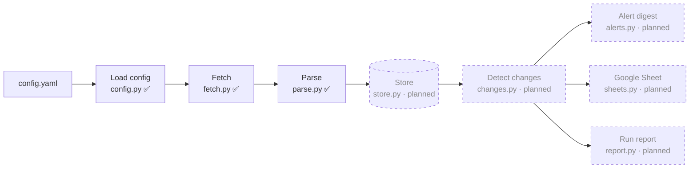
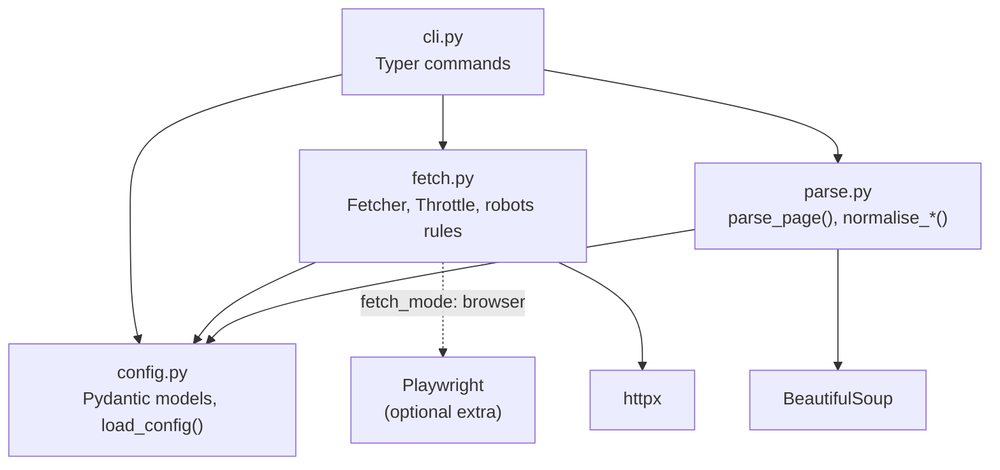
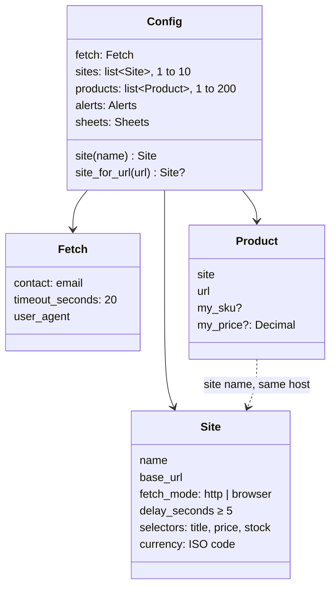
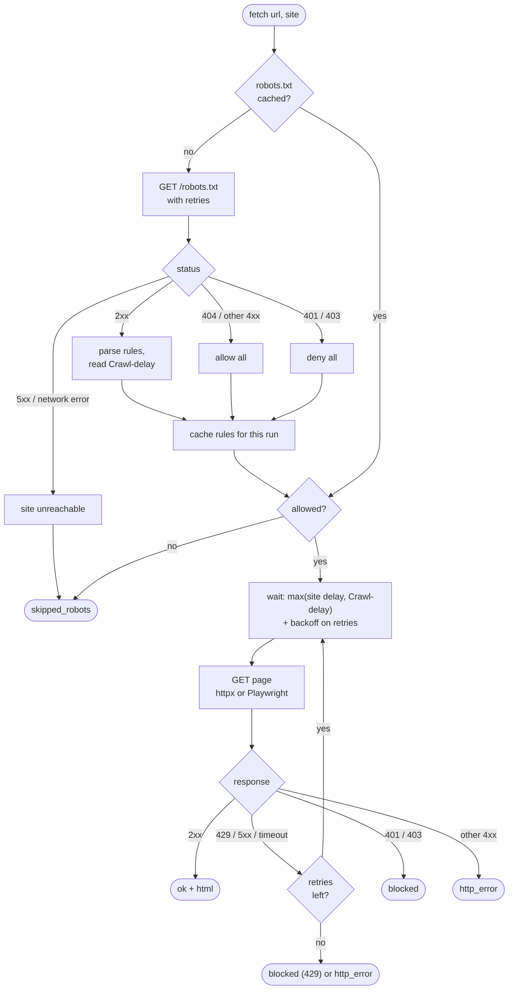
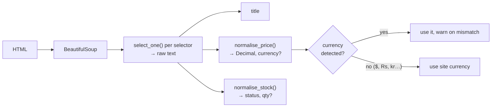
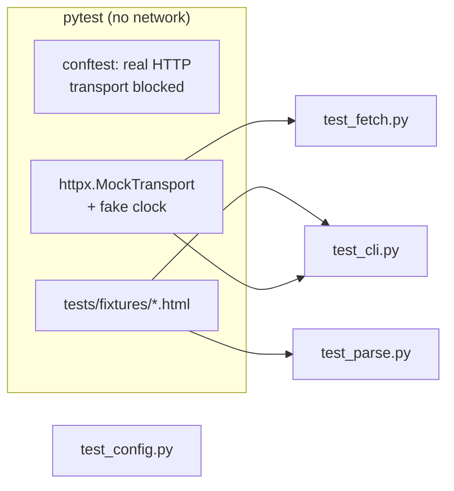

# Architecture

How the Competitor Price and Stock Tracker is put together. This file is updated at the end of
every build session; parts not built yet are marked **planned**.

| Session | Scope | Status |
|---|---|---|
| 1 | Repo skeleton, config loading (F1), CLI shell (F11), CI | ✅ done |
| 2 | Fetching (F2), robots.txt (F3), parsing (F4), `test-selectors` | ✅ done |
| 3 | SQLite store (F5), change detection (F6, F7), mock competitor site | planned |
| 4 | Email/Slack digest (F8), Sheets export (F9), health report (F12), `run` | planned |
| 5 | GitHub Actions schedule (F10), README, demo | planned |

## The daily pipeline

One command (`tracker run`) runs a straight pipeline. A product that fails at any step is
recorded and skipped; it never stops the other products.

## Modules

| Module | Responsibility | Never does |
|---|---|---|
| `config.py` | Reads YAML, validates with Pydantic, turns errors into one line per field (`products[2].site: unknown site 'x'`). Rejects secret-looking keys. Checks CSS selectors compile. | Reads secrets (they come from env vars) |
| `fetch.py` | One `Fetcher` per run. Checks robots.txt, waits between requests per site, retries, returns a `FetchResult`. | Raises on a bad page, bypasses blocks or CAPTCHAs |
| `parse.py` | Applies a site's selectors, normalises price text to `Decimal` + currency and stock text to a status + quantity. | Uses floats for money |
| `cli.py` | `check-config` and `test-selectors` work; `run` and `history` are stubs until sessions 3–4. | Holds business logic |

## Config (F1)

Validation runs in two passes: field checks first (types, ranges, unknown keys), then
cross-field checks (product site exists, product host matches its site, no duplicate URLs or
site names). Cross-field errors only show once field errors are fixed.

## Fetching (F2, F3)

Each product page goes through the same gate. robots.txt is fetched once per site per run and
cached; the robots.txt request itself counts toward the site's delay.

**Timing rules**

- At least `delay_seconds` (≥ 5) between any two requests to the same site; `Crawl-delay`
  from robots.txt wins when it is larger. Different sites don't wait on each other.
- Up to 3 retries. Each retry waits the site delay **plus** 1 s, 2 s, 4 s backoff (+ jitter).
  `Retry-After` on a 429 is honoured, capped at 60 s.
- Sleep, clock and jitter are injected, so tests run instantly with a fake clock.

**Status values** match the `observations.status` column planned for session 3:
`ok`, `http_error`, `blocked`, `skipped_robots` (and `parse_error`, set by the parser).

**User-Agent:** `price-tracker/<version> (+mailto:<fetch.contact>)`; robots.txt rules are
matched against the `price-tracker` token.

## Parsing (F4)

- **Missing title or price** → `parse_error`, naming the selector that matched nothing. What
  did match is kept, which helps with debugging. **Missing stock** → `unknown`, not an error.
- **Prices:** if both `,` and `.` appear, the last one is the decimal separator. A single
  separator followed by exactly three digits is a thousands separator (`1,299` and `1.299`
  both become 1299). A space joins digit groups only before exactly three digits. When text
  has several numbers (`From $9`, ranges, `Was $24 Now $19`) the lowest is taken.
- **Stock:** pre-order/backorder → `unknown`; out-of-stock phrases → `out_of_stock`; a
  quantity (`22 available`, `Only 3 left`) → `in_stock` with qty (0 → `out_of_stock`); other
  in-stock phrases, including an "Add to cart" button → `in_stock`; anything else → `unknown`.

## Testing

- An autouse fixture makes any real HTTP request fail, so no test can touch a live site.
- Fixtures were saved once from the practice sites (see `tests/fixtures/README.md`), plus two
  synthetic variants for out-of-stock and a changed layout.
- CI (`.github/workflows/ci.yml`) runs ruff lint + format check, `check-config` on the
  example, and pytest with an 80% coverage gate.

## Decisions

| Decision | Why |
|---|---|
| BeautifulSoup over selectolax | Better known, easier for a client's developer to maintain; speed is irrelevant at ≤200 pages/day |
| robots.txt 401/403 → treat as disallow | Stricter than RFC 9309; a site hiding its robots.txt gets left alone |
| robots.txt 5xx / unreachable → skip the site | Don't assume permission we can't verify |
| Ambiguous symbols (`$`, `Rs`, `kr`) use the site currency | `$` alone could be USD, CAD, AUD…; the site config knows |
| Money as `Decimal`, floats from YAML go through `str` | `49.99` stays exactly `49.99` |
| Product host must match its site's `base_url` | Catches copy-paste mistakes in config before any request |
