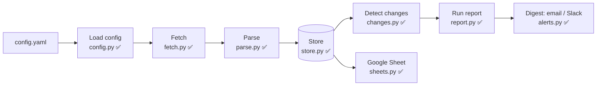
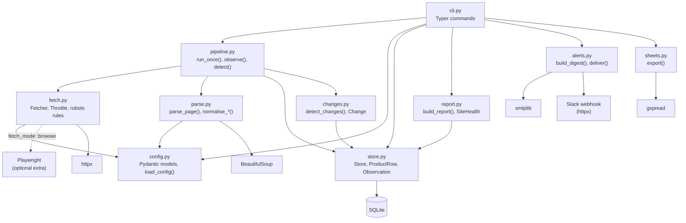
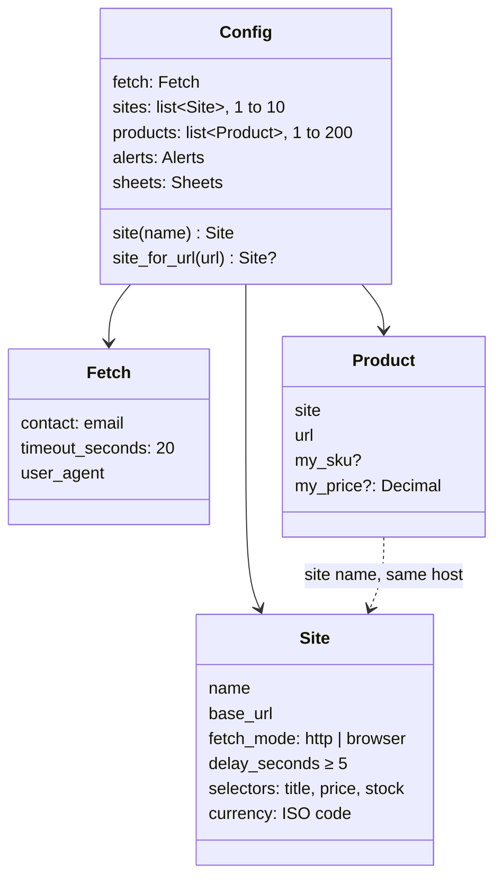
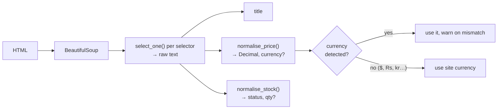
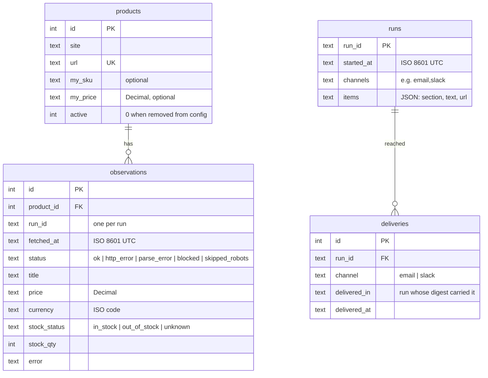
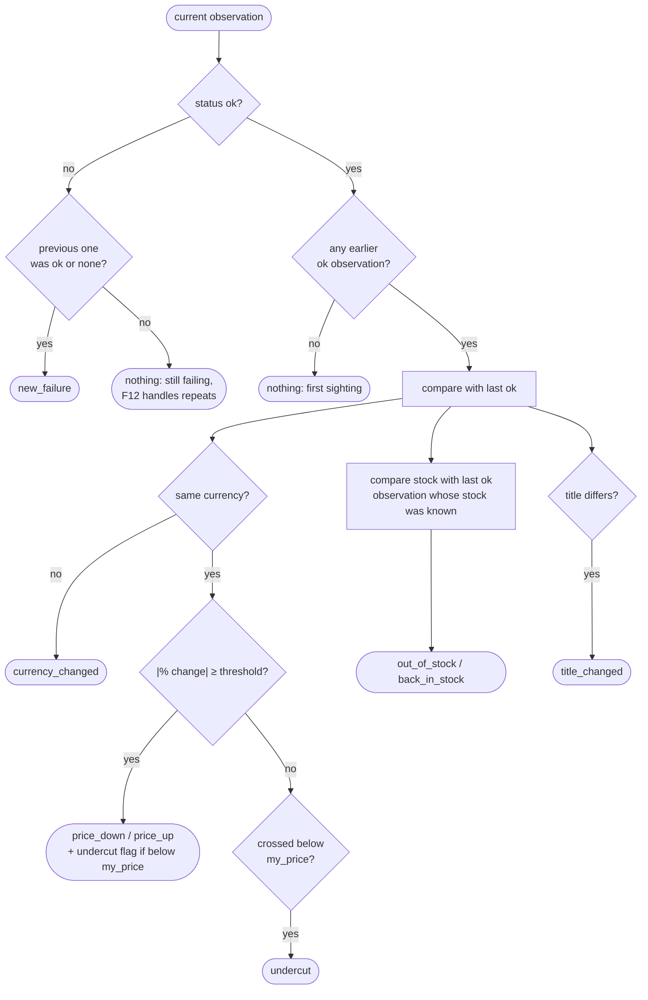
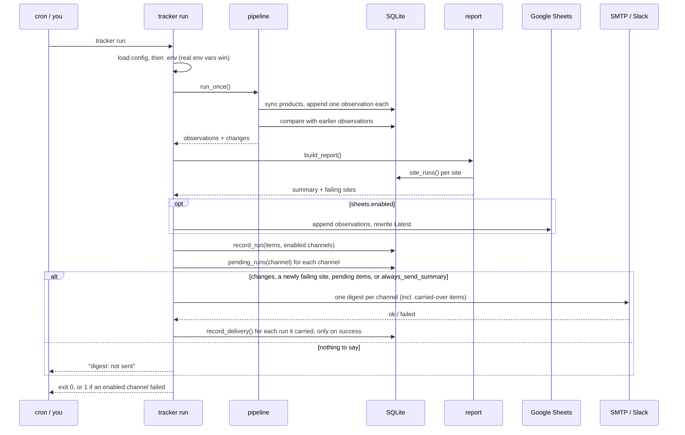
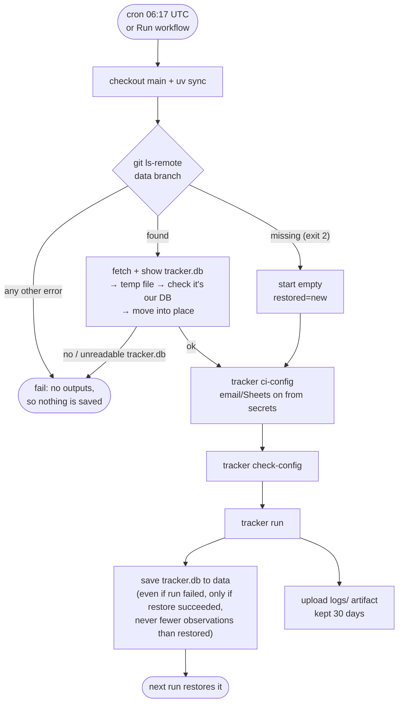
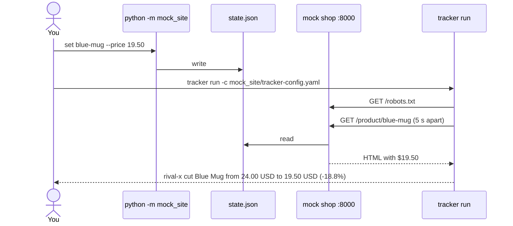
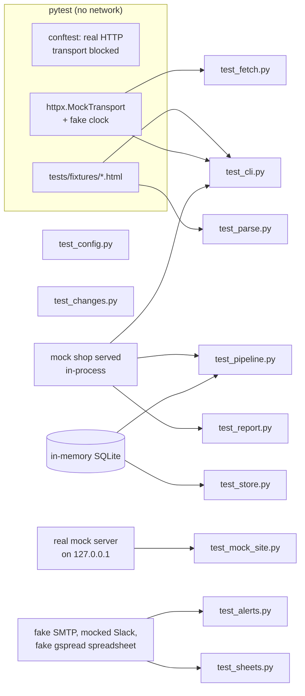

# Architecture

How the Competitor Price and Stock Tracker is put together. This file is updated at the end of
every build session; parts not built yet are marked **planned**.

| Session | Scope | Status |
|---|---|---|
| 1 | Repo skeleton, config loading (F1), CLI shell (F11), CI | ✅ done |
| 2 | Fetching (F2), robots.txt (F3), parsing (F4), `test-selectors` | ✅ done |
| 3 | Price fix (F4), SQLite store (F5), change detection (F6, F7), `history` + `run` printing changes (F11), mock competitor site | ✅ done |
| 4 | Email/Slack digest (F8), Sheets export (F9), health report (F12), hooked into `run` | ✅ done (email and Sheets both verified for real) |
| 5 | GitHub Actions schedule (F10), JSON logs, Dependabot, secrets scan, README, demo | ✅ done (first scheduled run due 2026-10-19) |

## The daily pipeline

One command (`tracker run`) runs a straight pipeline. A product that fails at any step is
recorded and skipped; it never stops the other products. `pipeline.run_once()` collects and
detects; `cli.run` then builds the report, exports to Sheets and sends the digest.

## Modules

| Module | Responsibility | Never does |
|---|---|---|
| `config.py` | Reads YAML, validates with Pydantic, turns errors into one line per field (`products[2].site: unknown site 'x'`). Rejects secret-looking keys. Checks CSS selectors compile. | Reads secrets (they come from env vars) |
| `fetch.py` | One `Fetcher` per run. Checks robots.txt, waits between requests per site, retries, returns a `FetchResult`. | Raises on a bad page, bypasses blocks or CAPTCHAs |
| `parse.py` | Applies a site's selectors, normalises price text to `Decimal` + currency and stock text to a status + quantity. | Uses floats for money |
| `store.py` | SQLite: syncs `products` from config, appends `observations`, records `runs`/`deliveries`, answers "previous", "previous ok", "previous with known stock" and history queries. | Updates or deletes an observation (triggers forbid it) |
| `changes.py` | Pure function from (product, current, previous observations) to a list of `Change`s with human-readable `describe()`. | Touches the network or database |
| `pipeline.py` | One run: sync products, interleave them across sites, fetch → parse → record each, then detect changes for the run. | Lets one product's exception stop the run |
| `report.py` | Run summary and site health: a site whose products **all** fail 2 runs in a row is flagged once. | Sends anything |
| `alerts.py` | Builds one digest per run (text, HTML, Slack blocks), adds anything a channel missed, sends it by SMTP and/or Slack webhook, and marks what got through. | Reads secrets from config, or raises on a failed send |
| `sheets.py` | Appends the run's observations and rewrites the "Latest" tab through a service account. | Lets a competitor's text become a formula (writes RAW) |
| `datasync.py` | `tracker data restore/save`: the history database on a git branch between scheduled runs. | Starts empty unless the branch is truly missing; shows the remote URL or token |
| `ci.py` | `tracker ci-config`: a run's config from a committed one plus secrets. | Prints a secret value |
| `cli.py` | `check-config`, `test-selectors`, `run [--dry-run]`, `history`, `data`, `ci-config`, `--version`; loads `.env`; wires report → Sheets → digest. | Holds business logic |

## Config (F1)

Validation runs in two passes: field checks first (types, ranges, unknown keys), then
cross-field checks (product site exists, product host matches its site, no duplicate URLs or
site names). Cross-field errors only show once field errors are fixed.

## Fetching (F2, F3)

Each product page goes through the same gate. robots.txt is fetched once per site per run and
cached; the robots.txt request itself counts toward the site's delay.

**Timing rules**

- At least `delay_seconds` (≥ 5) between any two requests to the same site; `Crawl-delay`
  from robots.txt wins when it is larger. Different sites don't wait on each other.
- Up to 3 retries. Each retry waits the site delay **plus** 1 s, 2 s, 4 s backoff (+ jitter).
  `Retry-After` on a 429 is honoured, capped at 60 s.
- Sleep, clock and jitter are injected, so tests run instantly with a fake clock.

**Status values** match the `observations.status` column:
`ok`, `http_error`, `blocked`, `skipped_robots` (and `parse_error`, set by the parser).

**User-Agent:** `price-tracker/<version> (+mailto:<fetch.contact>)`; robots.txt rules are
matched against the `price-tracker` token.

## Parsing (F4)

- **Missing title or price** → `parse_error`, naming the selector that matched nothing. What
  did match is kept, which helps with debugging. **Missing stock** → `unknown`, not an error.
- **Prices:** if both `,` and `.` appear, the last one is the decimal separator. A single
  separator followed by exactly three digits is a thousands separator (`1,299` and `1.299`
  both become 1299). A space joins digit groups only before exactly three digits.
- **Picking the price when text has several numbers:**
  1. Drop numbers that aren't prices: percentages (`Save 15%`), multi-buy counts
     (`2 for $30`, `Buy 2`), ratings and review counts (`4.5 stars`, `128 reviews`),
     discount amounts (`Save $5`, `$5 off`) and stock counts (`3 left`).
  2. Prefer numbers next to a currency symbol or code over bare numbers.
  3. Of what's left, take the lowest (`From $9`, `$19.99 - $24.99`, `Was $24 Now $19`).
- **Stock:** pre-order/backorder → `unknown`; out-of-stock phrases → `out_of_stock`; a
  quantity (`22 available`, `Only 3 left`) → `in_stock` with qty (0 → `out_of_stock`); other
  in-stock phrases, including an "Add to cart" button → `in_stock`; anything else → `unknown`.

## Storage (F5)

Two tables hold the data, as in the spec: `products` and `observations`. Two more record
what each run's digest had to say and where it got to (see "Undelivered digests" below). Prices are stored as **text** Decimals (SQLite has no decimal
type, and floats would turn 19.50 into 19.4999…). Triggers make `observations` append-only.

All four tables are append-only where it matters: triggers block UPDATE and DELETE on
`observations`, `runs` and `deliveries`.

- `database:` in config (default `tracker.db`) is resolved relative to the config file.
- Products are upserted by URL each run; ones removed from config get `active = 0` and keep
  their history.
- `tracker run --dry-run` copies the database into memory (`Store.scratch_copy`) and runs
  there, so it sees real history but writes nothing.

## Change detection (F6, F7)

Each observation in a run is compared with earlier ones for the same product:

- **Threshold** (`alerts.min_change_percent`, default 1) is inclusive and uses the signed %
  change rounded to 0.1.
- **Undercut (F7):** `my_price` is assumed to be in the site's configured currency, so it is
  only compared when the competitor's price uses that currency. A move below `my_price` is
  reported **once**: as the price change's undercut flag, or as a separate `undercut` change
  when the move itself was under the threshold.
- **Last good observation:** failed runs in between don't hide a change; `24.00 → (failed) →
  19.50` is still a price drop. Stock skips `unknown` the same way.

## One run, end to end (F8, F9, F12)

**Digest.** One message per run, never one per change. Sections, in order: Undercutting you,
Price changes, Stock, Other changes, Couldn't check, Site health, then the run summary.
- Email is `multipart/alternative`: plain text and HTML with inline styles (many clients drop
  `<style>`), one column, max 600 px.
- Slack gets Block Kit sections with the same content.
- Titles and errors come from competitor pages, so they're HTML- or Slack-escaped.

**When it's sent.** When there are changes, or a site has just reached 2 failing runs, or
`always_send_summary` is on. A site that keeps failing stays in the Site health section,
but doesn't force a send every day.

**Secrets.**

| Variable | Used for |
|---|---|
| `SMTP_HOST`, `SMTP_PORT` (587), `SMTP_USER`, `SMTP_PASSWORD`, `SMTP_FROM`, `SMTP_SECURITY` (starttls / ssl / none) | Email |
| `SLACK_WEBHOOK_URL` (must be `https://hooks.slack.com/…`) | Slack |
| `GOOGLE_SERVICE_ACCOUNT_JSON` (path to the key file) | Sheets |

They're read from the environment, or from `.env` next to the config or in the current
folder; real environment variables always win. `check-config` warns when an enabled
channel is missing one.

**Sheets layout.**
- "Observations": one row per product per run, appended.
- "Latest": rewritten every run, with one row per active product and an `undercuts_me`
  column.
- Prices are number cells formatted `0.00`, so the sheet can sort by them; everything else
  is written RAW.
- This is the **one deliberate exception to "Decimal, never float"**: Sheets stores every
  number as a double anyway, so prices are converted at this output boundary only. The
  database stays exact.
- "Latest" is overwritten from A1 and only then trimmed below the new last row, so a failed
  write leaves the last good data in place rather than an empty tab.

**Undelivered digests.** Observations are saved before anything is sent, so a failed send
would otherwise lose the alert: the next run compares against the new prices and sees
nothing to report. Instead:
1. Every real run writes a `runs` row with the items its digest had to say (changes and new
   site alerts) and the channels that were enabled.
2. Before sending, each channel looks up earlier runs with items that never reached it.
   They go into that channel's digest under **"From earlier runs that couldn't be sent"**,
   oldest first, each labelled with its run's time.
3. A `deliveries` row is written per run per channel **only after a successful send**.

Pending is tracked per channel, so a broken Slack webhook doesn't make email repeat itself.
Runs from before a channel was enabled are never carried to it. A dry run records, marks
and sends nothing.

**Exit codes.** `run` exits 1 when an enabled channel (email, Slack or Sheets) fails, so a
scheduled run shows up red. Products that can't be checked don't fail the run; they appear
in the digest.

## Daily schedule (F10)

`.github/workflows/daily.yml` runs at 06:17 UTC and from the **Run workflow** button, in the
public repo `yahani/price-tracker`. Every Actions runner starts empty, so the database lives
on a separate `data` branch between runs:

- **One run at a time:** `concurrency: daily-run` stops two runs racing to write `data`.
- **Single-commit `data` branch:** it's rebuilt as one commit and force-pushed each run, so
  the repo doesn't grow by a database copy a day. The database is append-only, so it already
  holds every observation.
- **Saving runs even if the tracker exits 1:** a failed email still records which runs are
  waiting to be sent, and the next run carries them over.
- **Never overwriting history with an empty database** (`tracker data restore|save`, in `datasync.py`):
  - Only a branch that's missing, per `ls-remote` exit 2, starts empty.
  - An unreachable remote, a missing or unreadable `tracker.db`, or a save with fewer
    observations than were restored all fail without pushing.
  - The token-bearing remote URL is never printed.
- **Recipients are never printed or logged:** delivery details give a count ("sent to 1
  recipient"), and SMTP errors are scrubbed of addresses. On Actions, `tracker ci-config` masks
  each recipient separately, because log artifacts of a public repo are downloadable.
- **Secrets are never committed:** `DIGEST_EMAIL_TO`, `SMTP_*`, `SHEETS_SPREADSHEET_ID` and
  `GOOGLE_SERVICE_ACCOUNT_KEY` are repository secrets. `tracker ci-config` reports only on/off
  and counts. The service-account key is written to the runner's temp folder with mode 600.
- **What it tracks:** the products in `demo/books-sandbox.yaml`, 20 books on a practice site.
  Point `CONFIG` at another committed config to track real competitors.

## Logs

`logs.py` writes one JSON object per line to `logs/tracker-YYYY-MM-DD.jsonl`, next to the
config. Files older than `logs.keep_days` (30) are deleted at the start of each run. Each
line has `ts`, `level`, `logger` and `msg`, plus extra fields from
`extra={"fields": {...}}`:

| Record | Fields |
|---|---|
| httpx `HTTP Request: GET …` | every request made, as an audit trail of politeness |
| `tracker.fetch` warnings | retries, blocks, robots skips |
| `change` | run_id, kind, url, text |
| `run_finished` | run_id, checked, succeeded, failed, changes, failing_sites, carried, deliveries, seconds |

A dry run writes no log, in keeping with "no writes".

## Mock competitor shop

`mock_site/` is a stdlib HTTP server for demos and end-to-end checks. Its state is a JSON file
re-read on every request, so changes show up on the tracker's next run without a restart.

- Pages: `/`, `/product/<slug>`, `/robots.txt` (disallows `/admin`), and `/admin` with forms
  to change price and stock (handy for the demo video).
- `mock_site/tracker-config.yaml` points the tracker at it, with `my_price` set on each product.
- One product's price text includes a "2 for $20" promo, to show the price fix working.

## Testing

- An autouse fixture makes any real HTTP request through httpx fail, so no test can touch a
  live site. `test_mock_site.py` is the one place a real server runs, on localhost.
- Another autouse fixture clears every `SMTP_*`, `SLACK_*` and `GOOGLE_*` variable and stops
  the CLI from reading `.env`, so a developer's real secrets never reach a test.
- The fake gspread spreadsheet is checked against gspread's real method signatures, so a
  library change shows up as a failing test.
- `test_pipeline.py` is the end-to-end check: the mock shop served through
  `httpx.MockTransport`, through fetch, parse, store and change detection.
- Fixtures were saved once from the practice sites (see `tests/fixtures/README.md`), plus two
  synthetic variants for out-of-stock and a changed layout.
- CI (`.github/workflows/ci.yml`) has two jobs:
  - **test:** ruff lint and format check, `check-config` on the example, and pytest with an
    80% coverage gate.
  - **secrets:** gitleaks over the full history.
- Dependabot (`.github/dependabot.yml`) opens weekly PRs for uv packages and GitHub Actions,
  and CI checks each one.

## Decisions

| Decision | Why |
|---|---|
| BeautifulSoup over selectolax | Better known, easier for a client's developer to maintain; speed is irrelevant at ≤200 pages/day |
| robots.txt 401/403 → treat as disallow | Stricter than RFC 9309; a site hiding its robots.txt gets left alone |
| robots.txt 5xx / unreachable → skip the site | Don't assume permission we can't verify |
| Ambiguous symbols (`$`, `Rs`, `kr`) use the site currency | `$` alone could be USD, CAD, AUD…; the site config knows |
| Money as `Decimal`, floats from YAML go through `str` | `49.99` stays exactly `49.99` |
| Product host must match its site's `base_url` | Catches copy-paste mistakes in config before any request |
| Prices in SQLite as text | Exact Decimals; SQLite has no decimal type |
| Append-only observations enforced by triggers | "Never overwrite history" holds even for ad-hoc SQL |
| Compare with the last *successful* observation | A failed run in between doesn't hide or invent changes |
| One report per undercut event | The digest must list each real change exactly once |
| Zero price → `parse_error` | A parse glitch must not look like a +100% price rise |
| `run` prints changes in session 3 | `history` and the mock-site check need stored runs before alerts exist |
| Interleave products across sites | One site's delay overlaps requests to the others, so runs finish sooner |
| Site "fails" only when all its products fail | One broken page is a product problem; all broken means selectors or a block |
| Site-failing alert sent once, at 2 runs | Avoids a daily alarm while still listing the problem |
| Sheets written RAW, prices as numbers | No formula injection from competitor text; the sheet can still sort by price |
| `run` exits 1 when a channel fails | A broken SMTP password shows up as a red scheduled run, not silence |
| Email + Slack in one `deliver()`, Slack off by default | Demo uses email only; Slack is ready when a client asks |
| Carry undelivered digest items, per channel, in append-only tables | A failed send must not lose an alert, and history stays immutable |
| Site-health advice depends on the failure type | "Selectors changed" is wrong advice when the site is blocking us |
| SMTP TLS trusts the system store plus certifi | python.org's macOS Python has no root certificates until a manual step |
| History on a `data` branch, force-pushed as one commit | Free and permanent (the Actions cache can be evicted); the repo doesn't grow daily |
| The workflow builds its config from secrets | The recipient and sheet stay out of a public repo |
| Public repo | Portfolio link; a private repo would also be free at ~2 Actions minutes a day. Use private for real clients, because the `data` branch is readable |
| Start empty only on "branch missing" | A network error must fail the run, not erase the history |
| Delivery details are counts, not addresses | Logs and artifacts can be public; recipients are private |
