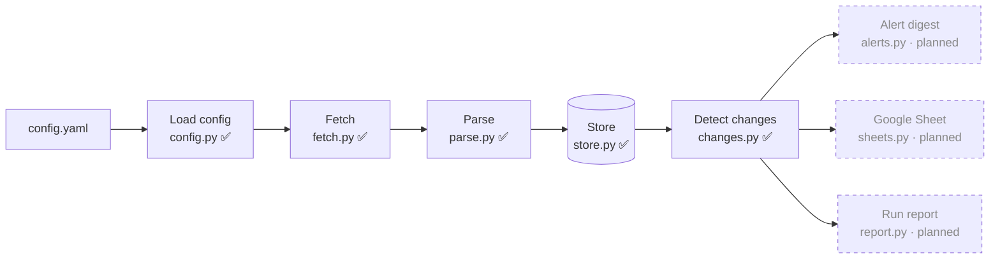
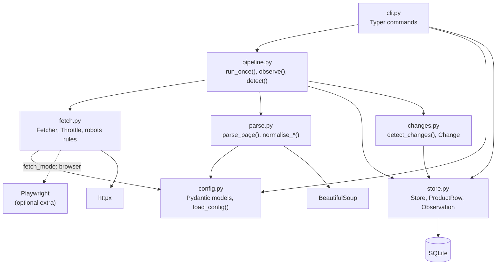
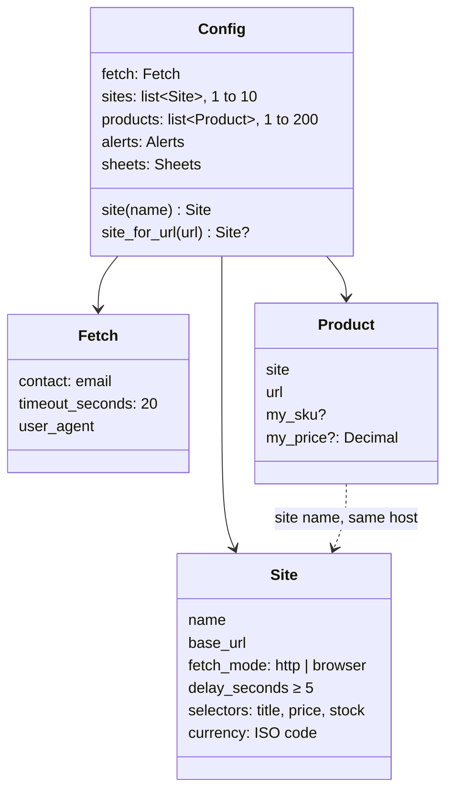
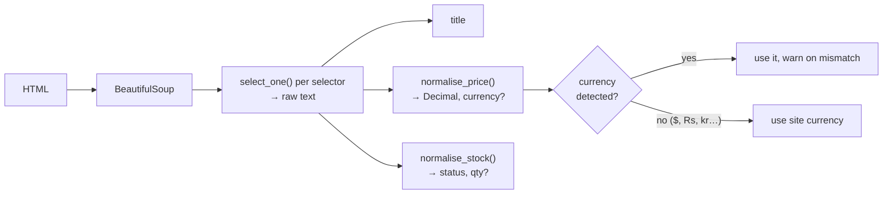
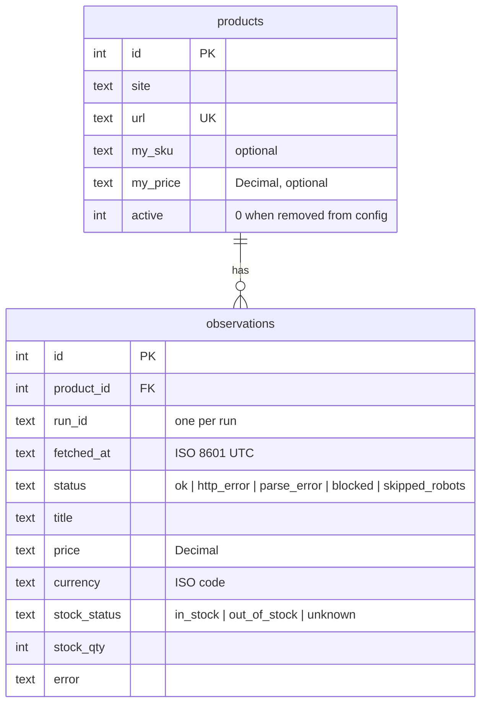
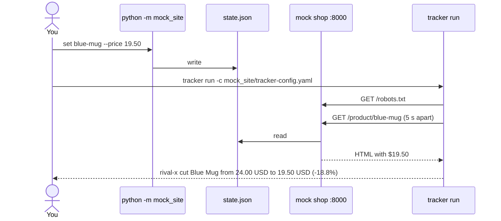
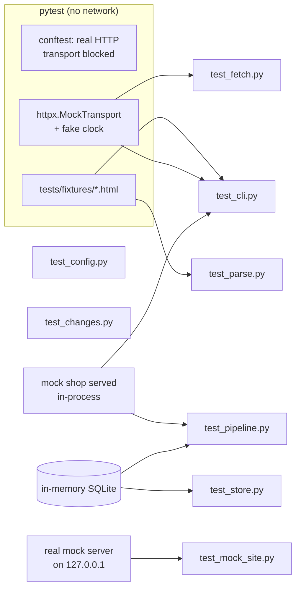

# Architecture

How the Competitor Price and Stock Tracker is put together. This file is updated at the end of
every build session; parts not built yet are marked **planned**.

| Session | Scope | Status |
|---|---|---|
| 1 | Repo skeleton, config loading (F1), CLI shell (F11), CI | ✅ done |
| 2 | Fetching (F2), robots.txt (F3), parsing (F4), `test-selectors` | ✅ done |
| 3 | Price fix (F4), SQLite store (F5), change detection (F6, F7), `history` + `run` printing changes (F11), mock competitor site | ✅ done |
| 4 | Email/Slack digest (F8), Sheets export (F9), health report (F12), hooked into `run` | planned |
| 5 | GitHub Actions schedule (F10), README, demo | planned |

## The daily pipeline

One command (`tracker run`) runs a straight pipeline. A product that fails at any step is
recorded and skipped; it never stops the other products. `pipeline.run_once()` drives it;
today `tracker run` prints the changes, and session 4 sends them as a digest instead.

## Modules

| Module | Responsibility | Never does |
|---|---|---|
| `config.py` | Reads YAML, validates with Pydantic, turns errors into one line per field (`products[2].site: unknown site 'x'`). Rejects secret-looking keys. Checks CSS selectors compile. | Reads secrets (they come from env vars) |
| `fetch.py` | One `Fetcher` per run. Checks robots.txt, waits between requests per site, retries, returns a `FetchResult`. | Raises on a bad page, bypasses blocks or CAPTCHAs |
| `parse.py` | Applies a site's selectors, normalises price text to `Decimal` + currency and stock text to a status + quantity. | Uses floats for money |
| `store.py` | SQLite: syncs `products` from config, appends `observations`, answers "previous", "previous ok", "previous with known stock" and history queries. | Updates or deletes an observation (triggers forbid it) |
| `changes.py` | Pure function from (product, current, previous observations) to a list of `Change`s with human-readable `describe()`. | Touches the network or database |
| `pipeline.py` | One run: sync products, interleave them across sites, fetch → parse → record each, then detect changes for the run. | Lets one product's exception stop the run |
| `cli.py` | `check-config`, `test-selectors`, `run [--dry-run]` (prints changes), `history`. | Holds business logic |

## Config (F1)

Validation runs in two passes: field checks first (types, ranges, unknown keys), then
cross-field checks (product site exists, product host matches its site, no duplicate URLs or
site names). Cross-field errors only show once field errors are fixed.

## Fetching (F2, F3)

Each product page goes through the same gate. robots.txt is fetched once per site per run and
cached; the robots.txt request itself counts toward the site's delay.

**Timing rules**

- At least `delay_seconds` (≥ 5) between any two requests to the same site; `Crawl-delay`
  from robots.txt wins when it is larger. Different sites don't wait on each other.
- Up to 3 retries. Each retry waits the site delay **plus** 1 s, 2 s, 4 s backoff (+ jitter).
  `Retry-After` on a 429 is honoured, capped at 60 s.
- Sleep, clock and jitter are injected, so tests run instantly with a fake clock.

**Status values** match the `observations.status` column planned for session 3:
`ok`, `http_error`, `blocked`, `skipped_robots` (and `parse_error`, set by the parser).

**User-Agent:** `price-tracker/<version> (+mailto:<fetch.contact>)`; robots.txt rules are
matched against the `price-tracker` token.

## Parsing (F4)

- **Missing title or price** → `parse_error`, naming the selector that matched nothing. What
  did match is kept, which helps with debugging. **Missing stock** → `unknown`, not an error.
- **Prices:** if both `,` and `.` appear, the last one is the decimal separator. A single
  separator followed by exactly three digits is a thousands separator (`1,299` and `1.299`
  both become 1299). A space joins digit groups only before exactly three digits.
- **Picking the price when text has several numbers:**
  1. Drop numbers that aren't prices: percentages (`Save 15%`), multi-buy counts
     (`2 for $30`, `Buy 2`), ratings and review counts (`4.5 stars`, `128 reviews`),
     discount amounts (`Save $5`, `$5 off`) and stock counts (`3 left`).
  2. Prefer numbers next to a currency symbol or code over bare numbers.
  3. Of what's left, take the lowest (`From $9`, `$19.99 - $24.99`, `Was $24 Now $19`).
- **Stock:** pre-order/backorder → `unknown`; out-of-stock phrases → `out_of_stock`; a
  quantity (`22 available`, `Only 3 left`) → `in_stock` with qty (0 → `out_of_stock`); other
  in-stock phrases, including an "Add to cart" button → `in_stock`; anything else → `unknown`.

## Storage (F5)

Two tables, as in the spec. Prices are stored as **text** Decimals (SQLite has no decimal
type, and floats would turn 19.50 into 19.4999…). Triggers make `observations` append-only.

- `database:` in config (default `tracker.db`) is resolved relative to the config file.
- Products are upserted by URL each run; ones removed from config get `active = 0` and keep
  their history.
- `tracker run --dry-run` copies the database into memory (`Store.scratch_copy`) and runs
  there, so it sees real history but writes nothing.

## Change detection (F6, F7)

Each observation in a run is compared with earlier ones for the same product:

- **Threshold** (`alerts.min_change_percent`, default 1) is inclusive and uses the signed %
  change rounded to 0.1.
- **Undercut (F7):** `my_price` is assumed to be in the site's configured currency, so it is
  only compared when the competitor's price uses that currency. A move below `my_price` is
  reported **once**: as the price change's undercut flag, or as a separate `undercut` change
  when the move itself was under the threshold.
- **Last good observation:** failed runs in between don't hide a change; `24.00 → (failed) →
  19.50` is still a price drop. Stock skips `unknown` the same way.

## Mock competitor shop

`mock_site/` is a stdlib HTTP server for demos and end-to-end checks. Its state is a JSON file
re-read on every request, so changes show up on the tracker's next run without a restart.

- Pages: `/`, `/product/<slug>`, `/robots.txt` (disallows `/admin`), and `/admin` with forms
  to change price and stock (handy for the demo video).
- `mock_site/tracker-config.yaml` points the tracker at it, with `my_price` set on each product.
- One product's price text includes a "2 for $20" promo, to show the price fix working.

## Testing

- An autouse fixture makes any real HTTP request through httpx fail, so no test can touch a
  live site. `test_mock_site.py` is the one place a real server runs, on localhost.
- `test_pipeline.py` is the end-to-end check: the mock shop served through
  `httpx.MockTransport`, through fetch, parse, store and change detection.
- Fixtures were saved once from the practice sites (see `tests/fixtures/README.md`), plus two
  synthetic variants for out-of-stock and a changed layout.
- CI (`.github/workflows/ci.yml`) runs ruff lint + format check, `check-config` on the
  example, and pytest with an 80% coverage gate.

## Decisions

| Decision | Why |
|---|---|
| BeautifulSoup over selectolax | Better known, easier for a client's developer to maintain; speed is irrelevant at ≤200 pages/day |
| robots.txt 401/403 → treat as disallow | Stricter than RFC 9309; a site hiding its robots.txt gets left alone |
| robots.txt 5xx / unreachable → skip the site | Don't assume permission we can't verify |
| Ambiguous symbols (`$`, `Rs`, `kr`) use the site currency | `$` alone could be USD, CAD, AUD…; the site config knows |
| Money as `Decimal`, floats from YAML go through `str` | `49.99` stays exactly `49.99` |
| Product host must match its site's `base_url` | Catches copy-paste mistakes in config before any request |
| Prices in SQLite as text | Exact Decimals; SQLite has no decimal type |
| Append-only observations enforced by triggers | "Never overwrite history" holds even for ad-hoc SQL |
| Compare with the last *successful* observation | A failed run in between doesn't hide or invent changes |
| One report per undercut event | The digest must list each real change exactly once |
| Zero price → `parse_error` | A parse glitch must not look like a +100% price rise |
| `run` prints changes in session 3 | `history` and the mock-site check need stored runs before alerts exist |
| Interleave products across sites | One site's delay overlaps requests to the others, so runs finish sooner |
