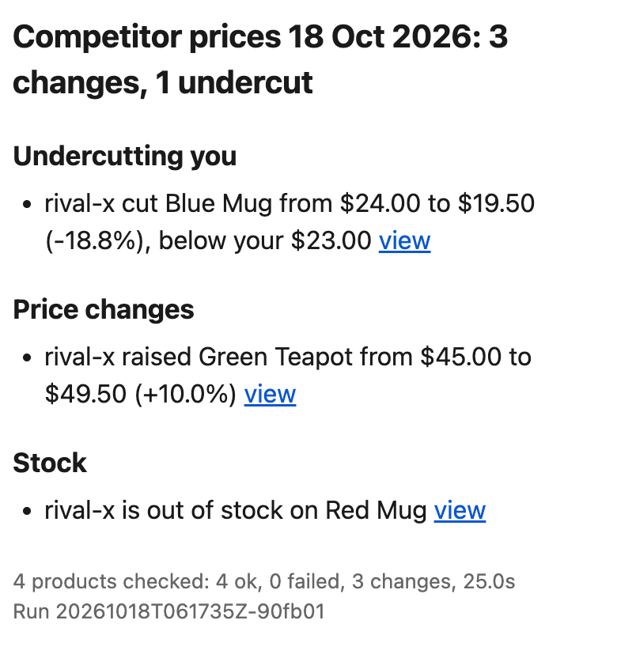

# Competitor Price and Stock Tracker

Checks a list of competitor product pages once a day, records price and stock, and sends
**one digest** when something changes, such as "Rival X cut Blue Mug from $24.00 to $19.50
and is out of stock on Red Mug". The full history is kept in SQLite and, optionally, in a
Google Sheet.

<p align="center"></p>

- **Polite by design.** It obeys robots.txt, waits at least 5 s between requests to a site
  (longer if robots.txt asks), and sends an honest User-Agent with a contact address. It
  never logs in or bypasses CAPTCHAs or anti-bot systems.
- **Reliable.** A broken page is recorded and skipped; it never stops the run. A site that
  fails two runs in a row gets its own alert. A digest that fails to send is carried into
  the next one.
- **Delivered where you work.** Email (any SMTP account), Slack, and a Google Sheet with a
  "Latest" tab and full history.
- **Cheap to run.** A free daily GitHub Actions schedule; nothing else to host.

## Quick start (about 10 minutes)

Requires Python 3.12 and [uv](https://docs.astral.sh/uv/getting-started/installation/).

```sh
git clone https://github.com/yahani/kestrel.git && cd kestrel
uv sync
uv run pytest
```

### See it work locally, with no email needed

The repo includes a tiny mock competitor shop whose prices you can change. Run it in one
terminal:

```sh
uv run python -m mock_site serve
```

In a second terminal:

```sh
uv run tracker run -c mock_site/tracker-config.yaml
uv run python -m mock_site set blue-mug --price 19.50
uv run python -m mock_site set red-mug --stock 0
uv run tracker run -c mock_site/tracker-config.yaml --dry-run
```

The first run records the starting prices. The dry run then lists both changes and prints
the digest it would send. Run it without `--dry-run` to store them, and use
`uv run tracker history MUG-BLUE -c mock_site/tracker-config.yaml` to see the history.
`uv run python -m mock_site reset` puts the prices back.

### Track real competitors

```sh
cp config.example.yaml config.yaml
cp .env.example .env
```

1. In `config.yaml`, set `fetch.contact` to your email address. It goes in the User-Agent so
   site owners can reach you.
2. Add a site per competitor, with CSS selectors for title, price and stock, and add the
   product URLs.
3. Check the selectors on one page: `uv run tracker test-selectors <product-url>`.
4. Put secrets in `.env`, never in `config.yaml`. See [docs/SETUP.md](docs/SETUP.md) for
   Gmail, Slack and Google Sheets.
5. Run `uv run tracker check-config`, then `uv run tracker run`.

Only track sites whose terms allow automated access: for client work, get that confirmed
in writing. Don't use it on big marketplaces such as Amazon.

## Commands

| Command | What it does |
|---|---|
| `tracker run [--dry-run]` | Check every product, store the results, export to Sheets, send one digest. `--dry-run` previews the digest and saves nothing. Exits 1 if an enabled channel fails to send. |
| `tracker check-config` | Validate the config and say which secrets are missing for enabled channels. |
| `tracker test-selectors <url> [--html FILE] [--save FILE]` | Show what each selector matched on one page and how it was read. |
| `tracker history <sku\|url\|part of url> [--limit N]` | Price and stock history for one product, newest first. |
| `tracker data restore\|save`, `tracker ci-config` | For scheduled runs: keep the history on a git branch, and build the run's config from secrets. |
| `tracker --version` | The installed release. |

All commands take `-c/--config` (default `config.yaml`). The database (`tracker.db`) and
`logs/` sit next to the config file.

## How it decides what to report

- **Price changes:** changes of at least `alerts.min_change_percent` (default 1%), compared
  with the last *successful* check, so a failed day in between doesn't hide anything.
- **Stock:** going in or out of stock.
- **Undercuts:** set `my_price` on a product to be told when a competitor goes below it.
- **Other:** title and currency changes.
- **Failures:** products that newly fail to load or parse.
- **Prices:** read exactly, as Decimals. Text like "From $9", "1.299,00 €" or
  "$49.99 Save 15%" is handled.
- **When a digest is sent:** only when something changed, unless
  `alerts.always_send_summary` is on.

## Run it daily on GitHub Actions

`.github/workflows/daily.yml` runs at 06:17 UTC every day, and from the **Run workflow**
button. It keeps the database on a `data` branch between runs and uploads the day's JSON
logs as an artifact. Email and Sheets settings come from repository secrets:

| Secret | For |
|---|---|
| `SMTP_HOST`, `SMTP_PORT`, `SMTP_USER`, `SMTP_PASSWORD`, `SMTP_FROM` | Email |
| `DIGEST_EMAIL_TO` | Who gets the digest (comma-separated) |
| `SHEETS_SPREADSHEET_ID`, `GOOGLE_SERVICE_ACCOUNT_KEY` | Google Sheets (optional; the key is the JSON file's contents) |

The workflow tracks the products in `demo/books-sandbox.yaml`, which are 20 books on a
practice site. Point `CONFIG` in the workflow at your own config to track real
competitors. [docs/SETUP.md](docs/SETUP.md) has the commands for setting the secrets.

> **Before tracking real products, use a private repository.** In a public repo, anyone can
> download the `data` branch's database, which holds your own prices (`my_price`) and every
> competitor observation. For client work, create a private repo from the **client template**
> (`yahani/kestrel-client-template`, private; its `CLIENT_SETUP.md` walks through
> setup, upgrades and handover). It installs this tracker at a pinned release tag (see
> [CHANGELOG.md](CHANGELOG.md)) and refuses to run in a public repo. Private repos are free
> at this volume too: about 2 Actions minutes a day against 2,000 a month.
>
> **GitHub turns off scheduled workflows in public repos after 60 days without activity**
> and emails the repo owner. To turn it back on, go to **Actions → Daily run → Enable
> workflow**, or run `gh workflow enable daily.yml`. Any commit also resets the 60 days.

## Project docs

- [docs/SETUP.md](docs/SETUP.md): Gmail, Google Sheets, Slack and GitHub Actions setup.
- [docs/DEMO.md](docs/DEMO.md): a 2-minute demo script.
- [ARCHITECTURE.md](ARCHITECTURE.md): how it fits together, with diagrams.
- [PROGRESS.md](PROGRESS.md): build status against the spec's requirements.
- [CHANGELOG.md](CHANGELOG.md): releases. Install one with
  `uv tool install --python 3.12 git+https://github.com/yahani/kestrel@v1.0.0`.

## Development

```sh
uv run pytest --cov=tracker
uv run ruff check . && uv run ruff format .
```

Tests never touch the network: real HTTP is blocked in `tests/conftest.py`, and no test can
see your real secrets or `.env`. CI runs lint, the tests (coverage at least 80%; currently
100%) and a gitleaks scan of the full history. Dependabot proposes dependency updates
weekly.

To track sites that need JavaScript, set `fetch_mode: browser` on the site and install the
extra: `uv sync --extra browser && uv run playwright install chromium`.
